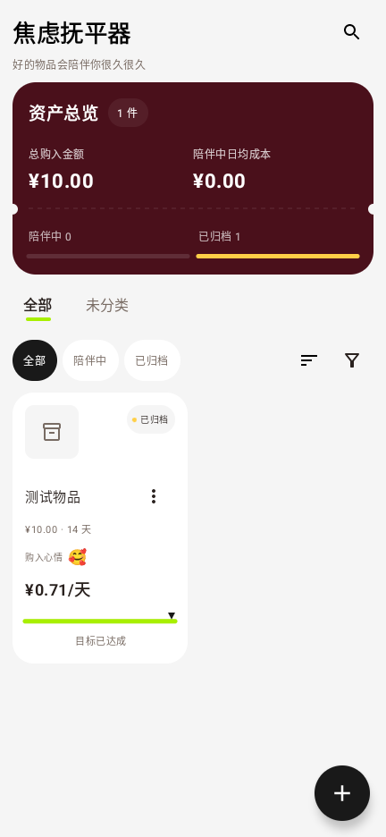

<p align="center"></p>

<h1 align="center">书史 · ShuShi</h1>
<p align="center">记下生活，写成你的历史。</p>
<p align="center">一个离线使用的 Android 记账 App。记收支、看分类支出，也记录物品的陪伴成本和存钱进度。</p>
<p align="center">
  <a href="https://github.com/zhang2311161648-a11y/shushi/releases/latest">下载安装</a> ·
  <a href="docs/USER_GUIDE.md">使用教程</a> ·
  <a href="docs/DEVELOPMENT.md">开发入门</a> ·
  <a href="https://github.com/zhang2311161648-a11y/shushi/issues">反馈问题</a>
</p>

## 为什么做书史

记一笔饭钱，应该是一件很快的事。书史把明细、记账入口、账户和图表放在容易找到的位置，希望你随手记完就能继续生活。

买了喜欢的东西，也可以记录它陪伴你的日子；想存钱，就建一个计划，慢慢填上每一次打卡。

## 能做什么

| 功能 | 用法 |
| --- | --- |
| 日常记账 | 记录收入、支出和账户转账，选择分类、日期和备注 |
| 账本与账户 | 管理多个账本和现金、银行卡、信用账户；查看余额 |
| 预算与统计 | 查看分类占比和消费排行；月度分类支出与上月比较 |
| 焦虑抚平器 | 记录物品价格、购入日期、照片和心情，计算日均或每次使用成本 |
| 存钱计划 | 设置目标和周期，用「存一笔 / 打卡存钱」记录进度 |
| 备份与导出 | 导出完整备份；CSV、PDF 用于查看和整理流水 |
| 外观与隐私 | 配色、深色模式、背景图、导航顺序和应用锁 |

当前版本以手动记账为主。AI、语音记账和支付自动识别已经移除。完整备份与 CSV 的区别见[备份教程](docs/USER_GUIDE.md#备份与换机)。

## 界面预览

以下为使用虚构物品生成的界面截图，金额不是维护者的私人账本。完整图集与来源见[图片说明](docs/images/README.md)。

| 焦虑抚平器：总览与使用成本 | 物品状态与操作入口 |
| --- | --- |
|  |  |

## 安装

1. 打开 [Releases](https://github.com/zhang2311161648-a11y/shushi/releases/latest)，下载 `shushi-v1.4.29.apk`。
2. Android 8.0 或更高版本打开 APK，按系统提示允许这次安装。
3. 首次使用先建一个账户，再点首页「+」记第一笔。

更新已有安装前，请在「我的 → 数据与备份 → 导出全部数据」保存完整备份。发布 APK 保留现有正式包名；自行编译的 debug 包名带 `.debug`，会与正式版并存。若系统提示签名不一致，请先确认包的来源并备份，详见[常见问题](docs/FAQ.md)。

## 从源码构建

需要 JDK 17 或更高版本、Android SDK 36 和网络连接以下载依赖。本次本地验证使用 Android Studio 自带的 JDK 21。

```bash
git clone https://github.com/zhang2311161648-a11y/shushi.git
cd shushi
./gradlew :app:assembleDebug
```

Windows 使用 `.\gradlew.bat :app:assembleDebug`。输出在 `app/build/outputs/apk/debug/app-debug.apk`。调试构建不需要维护者的签名密钥、Firebase 配置或付费服务。SDK 配置、测试命令和发布签名说明见[开发入门教程](docs/DEVELOPMENT.md)。

## 一起改进

欢迎提交问题、补充教程、修复错误或参与开发。先阅读[贡献说明](CONTRIBUTING.md)，反馈时附上版本、设备和复现步骤，截图请隐藏个人信息。公开仓库不接收私人账本、完整备份或签名文件。

本次开源版本与验证范围见[更新记录](CHANGELOG.md)和[验证记录](docs/VERIFICATION.md)。

## 来源与许可

书史基于 [Naveen Kumar Kuppan 的 Expense Manager](https://github.com/nkuppan/expensemanager) 改造，保留原作者版权声明，采用 [Apache License 2.0](LICENSE)。上游来源、改动清单和依赖说明分别见 [UPSTREAM](docs/UPSTREAM.md)、[NOTICE](NOTICE)、[THIRD_PARTY](docs/THIRD_PARTY.md)。

## English

ShuShi is an offline Android expense tracker built with Kotlin and Jetpack Compose. It supports manual expense/income entry, accounts, budgets, category statistics, savings plans, item ownership-cost tracking, and full backup/restore. Android 8.0+ is required. Download an APK from Releases or build `:app:assembleDebug`. This is a modified derivative of Expense Manager under Apache 2.0.
