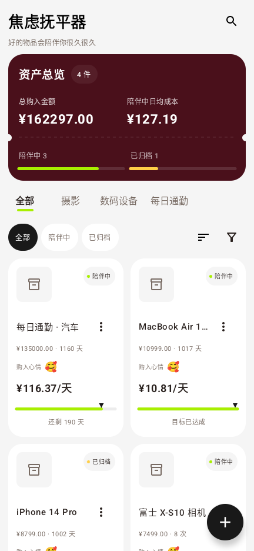

# 书史使用教程

适用于 v1.4.29。第一次使用，可以先用一个测试账户练习，熟悉之后再录入自己的记录。

## 安装和第一笔账

在仓库 Releases 下载 APK，系统要求 Android 8.0 及以上。安装完成后打开书史。

1. 进入账户管理，新建「现金」或「银行卡」账户，填写当前余额。
2. 回到明细页，点中间的「+」。
3. 选择支出，填写 `18`，分类选餐饮，选择付款账户，备注写「午饭」。
4. 检查日期与金额，保存后在明细中找到这笔记录。

收入的操作相同，类型改为收入。账户间转钱请选择转账，并选好转出、转入账户，避免把内部转账重复记成收入或消费。

## 账本、账户和余额

账本用于区分不同用途的记录，例如日常生活与旅行。账户表示钱放在哪里，例如现金或银行卡。建账户时的余额是记账起点，之后的流水会改变余额。

如果余额与实际不符，先核对起始余额、收入支出和转账，再检查是否有漏记或重复流水。删除或修改流水会影响账户计算。先做完整备份，再进行大范围整理。

## 查明细、看统计、设预算

明细页按日期展示记录，可用账户、类型、日期或搜索筛选。打开记录可修改内容，删除前确认目标记录。

图表页可查看分类占比和支出排行。月度分类排行会显示相对上一自然月的变化；周、年、账期模式不使用这个月度对比。预算用于观察已花金额与预算的关系，预算本身不会替你记一笔消费。

## 焦虑抚平器

进入「焦虑抚平器」，点「+」，填写物品名称、购入金额、日期和成本目标。照片、分类、心情、备注可以按需要补充。

- 按日计费：根据拥有天数计算平均每天的成本。
- 按次计费：通过使用次数计算平均每次的成本，使用后点一次使用按钮。
- 陪伴中 / 已归档：归档保留记录；旧版本的已卖出记录也归入已归档。
- 编辑 / 删除：点卡片右侧的更多菜单，或进入详情；删除会要求确认。

这里的「回本」是你自己设定的成本目标，没有出售收益或投资回报含义。物品记录与收支流水分开保存：新增或删除物品不会自动新增或删除一笔支出。要记购买支出，请在账本中另记。

## 存钱计划

打开存钱页面，选择计划类型，填写名称、目标金额、周期和开始、结束日期。创建后，点「存一笔 / 打卡存钱」，填写实际存入金额与日期，查看已存金额、剩余金额和进度。

这是手动记录存钱进度的工具，应用不会访问银行账户，也不会自动划款。旧版储蓄记录可在页面中展开查看。

## 备份与换机

进入「我的 → 数据与备份」，选择「导出全部数据」保存完整备份，尤其是在换机、更新、卸载或大规模编辑之前。

| 文件 | 适用用途 | 能否作为完整换机备份 |
| --- | --- | --- |
| 完整备份 ZIP | 保存账本、账户、流水、预算、物品、存钱计划与设置，并迁移应用管理的照片 | 是 |
| CSV | 用表格查看或追加导入流水 | 否 |
| PDF | 阅读、打印流水报告 | 否 |

恢复时选择完整备份，阅读确认提示。校验完成后退出并重新打开应用，恢复流程会保留恢复前副本，失败时回到原数据。完整恢复会替换当前数据，请先备份当前账本；CSV 导入是追加流水，不能替代完整恢复。

将完整备份复制到你自己控制的位置，检查文件确实保存成功。外部图片访问可能受系统权限与文件位置影响，换机后检查照片和背景图。备份包含个人记录，不要作为 GitHub 附件公开发送。

## 配色、背景和应用锁

「我的」中的设置可调整配色、深色模式、背景图和底部导航顺序。应用锁调用系统生物识别或设备凭据；需要先在 Android 系统中设置可用的解锁方式。

应用锁保护打开应用的入口，完整备份仍需要你妥善保管。更多问题见 [FAQ](FAQ.md)。
